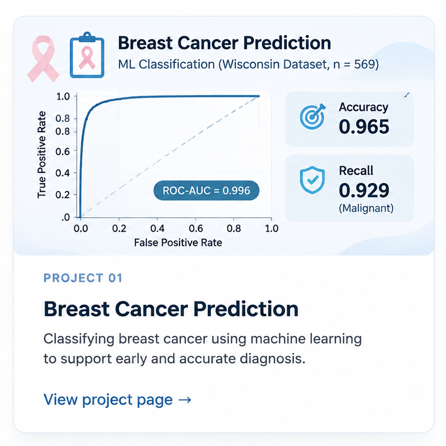
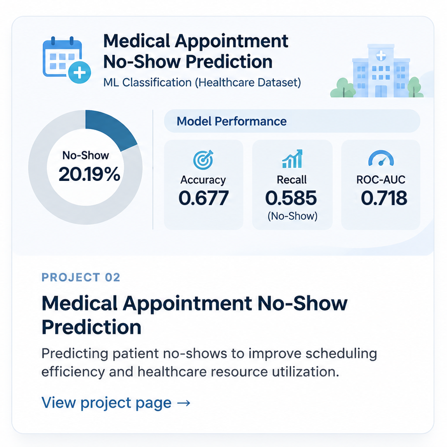

# Welcome

Hi, I'm Yoonjae! I'm a Stony Brook University graduate with a background in Technological Systems Management and a growing passion for data analytics, artificial intelligence, and healthcare technology.

Through academic projects and hands-on experience, I've developed an interest in using data to uncover meaningful patterns, solve real-world problems, and support better decision-making.

This portfolio is a collection of my work with Python, SQL, and machine learning, reflecting my curiosity, analytical approach, and commitment to continuous learning.

## Selected Projects

  
  

  
