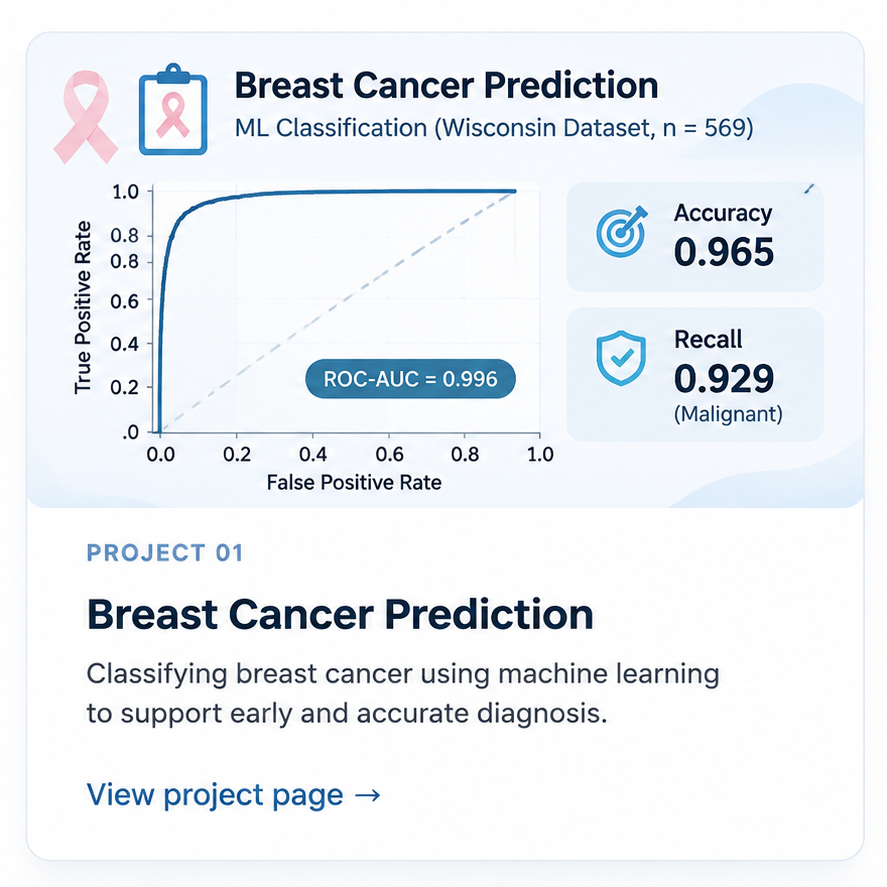
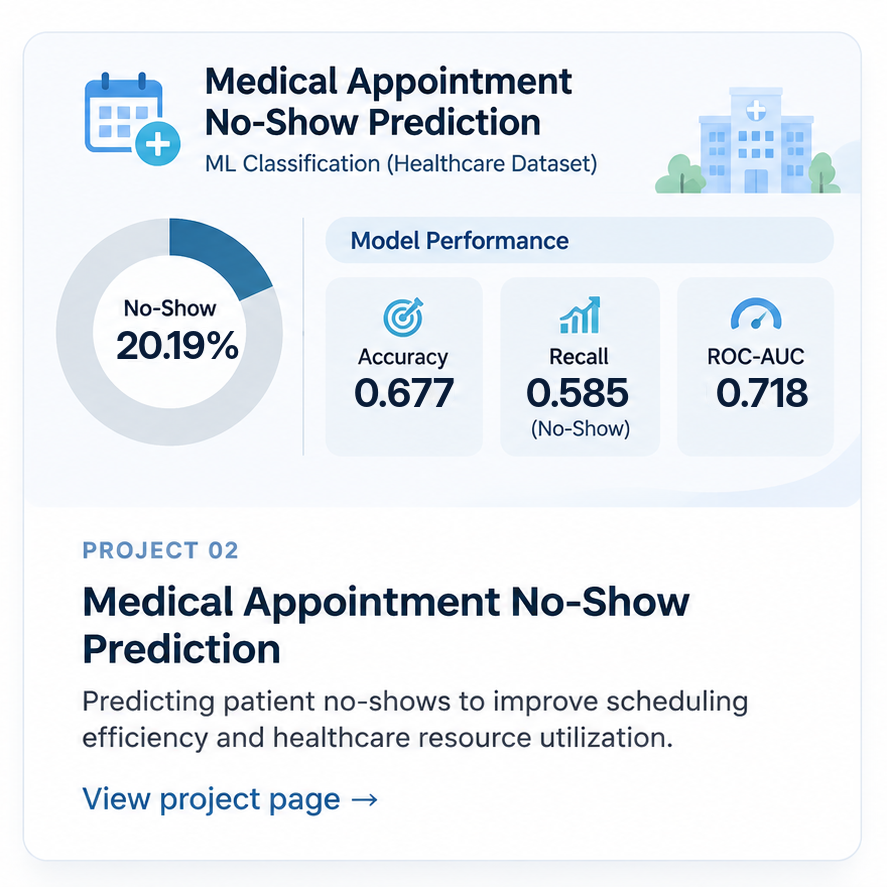

Explore my data analytics and machine learning projects, where I apply SQL, Python, and statistical methods to investigate real-world problems, build predictive models, and translate analytical findings into meaningful insights.

  
  

  
